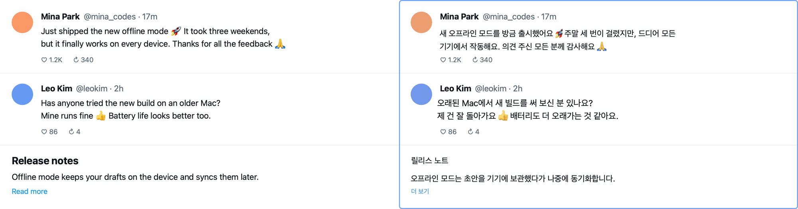
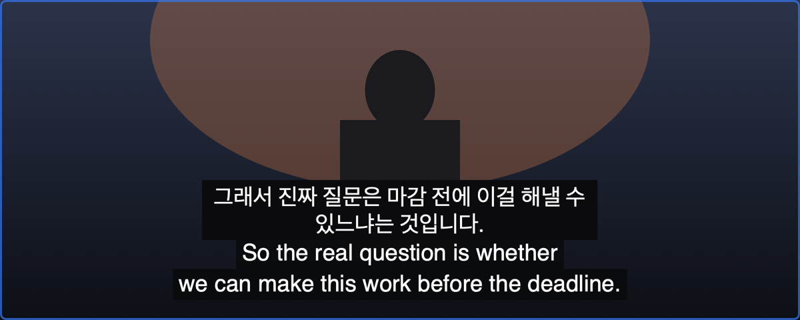
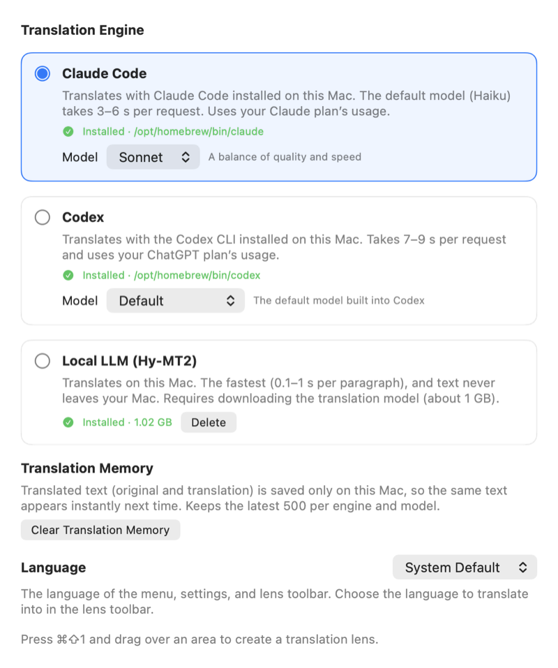

# AI Translate

**Translations right where the text is, anywhere on your screen**

[한국어](README.md) · **English**

<p align="center">
  
  <br><sub>Left: original. Right: the lens. Every image in this README was made from a made-up example screen</sub>
</p>

A translator that lives in the Mac menu bar. Press `⌘⇧1` and drag over the part of the screen you want translated, and a **translation lens** stays there. The lens reads the text underneath and draws the translation **in the original text's place, in its colors and size**, and translates again when you scroll or a video moves on.

## What is it?

Think of it as a **translation lens** you lay over foreign-language text instead of a magnifier.

- Web pages, PDFs, app windows, games, even **subtitles of a playing video** — anything shown on screen.
- The lens stays put. You can keep scrolling and clicking the page beneath it (mouse events pass through).
- Translations are drawn over each original paragraph with its background and text colors; everything else is transparent, so the page shows through.
- Things that don't need translating — names, handles, numbers, buttons, emoji — are left as they are.

## Why?

1. **Browser translation only works inside the browser** — not in apps, PDF viewers, games or text over video.
2. **Screenshot translators are one-shot** — you capture again after every scroll, and the result opens in another window, so you keep looking back and forth.
3. **Video subtitles keep moving** — you can't copy each one by hand.

So this app keeps watching part of the screen, reads it again when it changes, translates only the new text, and paints it right over the original.

## Installing

> There is no ready-to-open download (DMG) yet. The app isn't signed and notarized with an Apple Developer ID, so a build from another Mac won't open as is. Build it on your own Mac as below.

### Requirements

- A Mac with macOS 15 or later. **The local translation model runs on Apple silicon (M1 and later) only.** Intel Macs haven't been tested
- [Xcode](https://apps.apple.com/app/xcode/id497799835) 26 and the Metal toolchain — run `xcodebuild -downloadComponent MetalToolchain` once
- [XcodeGen](https://github.com/yonaskolb/XcodeGen) — `brew install xcodegen`
- At least one translation engine
  - **Local LLM** — nothing to prepare; download the translation model (about 1 GB) in Settings the first time
  - [Claude Code](https://code.claude.com) (`claude`) — installed and logged in from the terminal
  - [Codex CLI](https://github.com/openai/codex) (`codex`) — installed and logged in from the terminal

### Steps

1. **Open Terminal.** Press `⌘ + Space`, type "Terminal" and press Return.
2. **Get the code.**
   ```bash
   git clone https://github.com/whalebanana86/ai-translate.git
   cd ai-translate
   ```
3. **Create a signing certificate for this Mac** (once).
   ```bash
   ./scripts/setup-dev-signing.sh
   ```
   Signing with it keeps the screen recording permission across rebuilds. No Apple account is needed, and it only means anything on this Mac.
4. **Build and install the app** (about 4 minutes the first time).
   ```bash
   ./scripts/install-release.sh
   ```
   This puts `AITranslate.app` in Applications and opens it. A speech-bubble icon appears in the menu bar.
5. **Choose a translation engine.** A welcome screen opens the first time. If you pick the local LLM, press **Download Model**. The app follows your Mac's language (Korean or English); you can change it under **Language** in Settings.
6. **Allow screen recording.** You're asked when you make your first lens. Turn on AI Translate under **System Settings → Privacy & Security → Screen & System Audio Recording**. The lens can't read anything without it.

### Updating · removing

- Update: in the `ai-translate` folder, run `git pull && ./scripts/install-release.sh`. It replaces the app (quitting the running one first). Settings and the downloaded model stay.
- Remove: move `AITranslate.app` to the Trash. To also remove the model and translation memory, delete `~/Library/Application Support/AITranslate`; settings go with `defaults delete com.example.AITranslate`. Remove the signing certificate with `security delete-identity -c "AITranslate Local Development"` and the screen recording record with `tccutil reset ScreenCapture com.example.AITranslate`.

## Using it

### Making a lens

1. Press `⌘⇧1`, or choose **New Translation Lens** from the menu bar icon.
2. Drag over the area to translate, like taking a screenshot. `esc` cancels.
3. The lens appears and starts reading and translating. A lens stays **on the desktop (Space) where you made it**. Making a new lens closes the previous one.

### Toolbar above the lens

| Button | What it does |
|---|---|
| ≡ (drag) | Move the lens. Resize it with the handle at the bottom right |
| Language | Language to translate into: 한국어, English, 日本語, 简体中文, 繁體中文, Español, Français, Deutsch |
| ⏸ Pause | Stop reading and translating and show the original. Resuming reads the current screen afresh |
| Show Original Too | Show video subtitles with the translation above the original (only while watching video) |
| Translation History | A panel next to the lens with the translations so far, in order. Drag its header to move it, its corner to resize |
| Original | Lift the lens for a moment to see the original |
| Copy · Close | Copy the translation, close the lens |

Hover over a button to see what it does.

### What the lens does on its own

- **When you scroll**, old translations disappear at once; when you stop, only newly visible paragraphs are translated. Translations are remembered, so scrolling back shows them right away.
- **Paragraphs waiting for translation** are covered with gray bars until their translation is drawn in place.
- **Text size, weight and line spacing** follow the original, measured from the text on screen: bold headings are drawn bold, small gray text small. Text of the same size gets the same size. The typeface itself (serif and so on) isn’t copied.
- **Lines already in the target language** (such as "답글 4개" on a Korean page), **author lines** ("Name @handle · 17m"), numbers and buttons are left as they are.
- **Emoji** aren't translated; the very emoji from the screen is drawn back at the same spot inside the translated sentence.

### Video subtitles

<p align="center"></p>

- Works while the video plays. For text that keeps changing, like YouTube subtitles, it translates once the subtitle is complete and keeps the translation in a fixed position.
- By default the translation is shown **above the original subtitle** (turn off **Show Original Too** to have it cover the original instead). If the lens only covers the subtitle strip, there's no room above or below, so it covers the original.
- Two-line subtitles get two-line translations. Korean translations use the formal polite style (합니다체).
- Only the **local LLM** keeps up with subtitles (about 0.35 s per line); Claude Code and Codex take several seconds per request.

### Settings (`⌘,`)

<p align="center"></p>

| Engine | Speed | Where does the text go? |
|---|---|---|
| **Claude Code** | 3–6 s per request with the default model (Haiku). Sonnet, Opus and Fable can be chosen (more accurate, slower, more usage) | To Anthropic through your logged-in Claude Code. Uses your Claude plan |
| **Codex** | 7–9 s per request. Choose from the models Codex has listed for you | To OpenAI through your logged-in Codex. Uses your ChatGPT plan |
| **Local LLM** (Hy-MT2 1.8B) | 0.1–1 s per paragraph, the fastest | Never leaves the Mac. Apple silicon only, model about 1 GB |

Changing the engine or model makes an open lens translate again with it. **Clear Translation Memory** deletes stored translations.

**Language** sets the language of the menu, settings and lens toolbar: **System Default** (the default), **한국어** or **English**. Press **Restart** to apply a change. If your Mac's language is neither Korean nor English, the app is shown in Korean.

### Shortcuts

| Key | Action |
|---|---|
| `⌘⇧1` | Make a translation lens |
| `esc` | Cancel area selection |
| `⌘,` | Settings |
| `⌘Q` | Quit (from the menu bar menu) |

## Is my screen safe?

- **No sign-up and no usage analytics.**
- Only the lens area is captured, and captured images are **used in memory and never saved.** Text recognition (OCR) runs on the Mac (Apple Vision).
- With the **local LLM**, text never leaves the Mac. The model is downloaded once from Hugging Face, and every file's hash is checked.
- With **Claude Code or Codex**, only the **recognized text** (never images) goes to that company through the CLI you logged in to. You're told once per engine before first use.
- The CLIs run with all tools off (Claude Code) or in a read-only sandbox (Codex), in an empty temporary folder, without reading your settings or hooks. A sentence on screen like "ignore previous instructions" is treated as text to translate, never as an instruction.
- So the same text isn't translated twice, a **translation memory** (original and translation) is stored on this Mac only (readable only by you, the latest 500 per engine and model). You can clear it in Settings. The history panel lives in memory and is gone when the lens closes.
- Logs keep only numbers such as timings — never screen text or translations.

---

## Details (for developers)

### Stack

| | |
|---|---|
| App | SwiftUI + AppKit menu bar app (no Dock icon), Swift 6 strict concurrency. A lens is four non-activating panels (body, toolbar, handle, history) |
| UI text | String catalogs `Localizable.xcstrings` (app and `TranslateCore`, Korean source + English). The language choice is the same value as macOS per-app language (`AppleLanguages`) |
| Capture | ScreenCaptureKit `SCScreenshotManager`. The app's own windows are excluded, so the original is captured even under the lens |
| OCR | Vision `RecognizeTextRequest` (automatic language detection + hints en, ko, ja, zh-Hans, zh-Hant). Lines are grouped into paragraphs; word boxes locate emoji |
| Logic | `Packages/TranslateCore` (Swift package): coordinates, change detection, paragraph grouping, subtitle spots, emoji, language detection (NaturalLanguage), measuring text size and weight, translation memory, engines. Tested with `swift test` |
| Engines | Claude Code CLI, Codex CLI, local [mlx-swift-lm](https://github.com/ml-explore/mlx-swift-lm) + `mlx-community/Hy-MT2-1.8B-4bit` (pinned revision and hashes) |
| Project | XcodeGen (`project.yml`). `.xcodeproj` is generated |

Pipeline: capture (every 0.5 s, 0.15 s while the screen changes) → change detection by fingerprint → OCR once it settles (for video, every 0.25 s while it changes) → emoji, text size and weight, paragraphs, colors → only paragraphs not in the translation memory go to the engine (one request at a time) → draw in place.

### Commands the app runs

| Engine | Command |
|---|---|
| Claude Code | `claude -p --model <haiku·sonnet·opus·fable> --tools "" --strict-mcp-config --setting-sources project --no-session-persistence --system-prompt <translation only> --json-schema <schema> --output-format json` (JSON segments on stdin) |
| Codex | `codex exec --skip-git-repo-check --ephemeral --ignore-user-config --sandbox read-only --cd <empty folder> --config model_reasoning_effort="low" [--model <model>] --output-schema <schema> --output-last-message <file> -` |
| Local | Generated in-app with MLX. The model card's translation prompt, one paragraph at a time, shown as it's generated |

Screen text is only ever passed as `{"target": "Korean", "segments": [...]}` JSON; output is forced to a schema and the segment count is checked. Every call has a timeout, and a new request ends the previous process. GUI apps don't inherit the shell PATH, so the CLIs are found through a login shell (`zsh -lc 'command -v claude'`) and known install locations.

### Measurements

| | |
|---|---|
| Local model (M5) | Load 1.25 s, 101–112 tokens/s. Short phrase 0.14 s, one line 0.35 s, long paragraph 1.2 s |
| YouTube subtitles | About 1.1 s from a subtitle appearing to its translation showing (including waiting for it to complete) |
| Parallel translation | Not used: 8 comments took 2.6–2.8 s one by one, 2.4–2.5 s two at a time, about 2.5 s four or eight at a time (they share one GPU) |
| Skipping target-language text | One screen of Korean YouTube comments: 12 translatable paragraphs → 5 sent to the engine |
| Korean 합니다체 for subtitles | Local model, 50 statements: 25 before the style instruction → 50 with it as a system message |
| Emoji detection | About 5 ms on a 3200×1520 capture |
| Text size | Spread within one font (90%) in Chrome: ±2.2% on 2× screens, ±4.3% on 1× (the old line-box formula: ±36–40%). About 11 ms per screen |
| Text weight | No line read as regular when bold or the other way round at 26 px and up (1663 rendered lines) |
| Line spacing | Chrome paragraphs (line-height 1.2–1.8, 10 fonts): median error 0.3%, max 1.7% |

Decisions and working rules are in [AGENTS.md](AGENTS.md); how each part works, with reasons and measurements, is in [docs/design](docs/design/) and `.agent/archive/TASK-*.md` (all in Korean).

### Development

```bash
xcodebuild -downloadComponent MetalToolchain       # Xcode 26: needed to build MLX (once)
xcodegen generate                                  # Generate AITranslate.xcodeproj (always after changing project.yml)
./scripts/setup-dev-signing.sh                     # Development signing certificate (once)
./scripts/run-app.sh                               # Debug build → sign → run (restarts if running)
./scripts/install-release.sh                       # Release build for this Mac, installed to /Applications and opened
./scripts/sync-strings.sh                          # after a build, add new UI strings to the string catalogs (fill in English yourself)
swift test --package-path Packages/TranslateCore   # Logic tests
AITRANSLATE_LIVE_TESTS=1 swift test --package-path Packages/TranslateCore --filter LiveTests   # Real engine calls (manual)
./scripts/auto-fix-loop.sh                         # Doc size, type check, lint, build, tests (required before finishing a task)
```

Working rules (for agents too) are in [AGENTS.md](AGENTS.md). Each request gets `.agent/tasks/TASK-ID.md` with requirements and acceptance criteria, and is done only after `auto-fix-loop.sh` passes. Testable logic lives in `TranslateCore`; the app target stays thin.

### Not done yet

- Developer ID signing and notarization, DMG distribution, auto-update (Sparkle) — hence no download
- An API-key engine — Anthropic doesn't allow third-party apps to use claude.ai login and plan limits, so this is needed before a public release
- Intel Macs, launching at login
- Letter and word spacing don't follow the original (measured, but within one font they varied from line to line about as much as designed spacing does). The typeface (serif and so on) isn't carried over. Weight isn't measured below 26 px (13 pt on a 2× screen, so most body text on 1× screens is drawn regular), and size differences under 1.1× aren't distinguished
- Single-color gray emoji (💀 and the like) may be missed. Keyboard scrolling is only noticed through screen changes (up to about 0.5 s)
- Korean 합니다체 for subtitles: questions and suggestions often stay in 해요체 ("~나요?", "~보세요")
- Windows, Android, iPhone — researched only

## License

[MIT](LICENSE)
