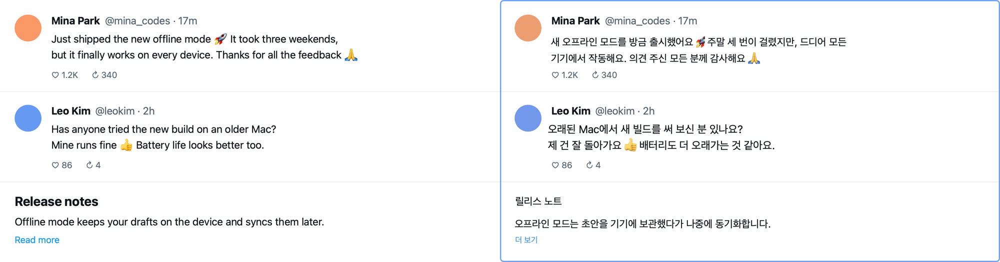
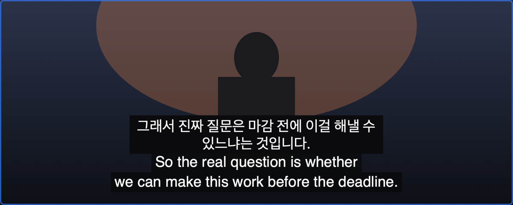
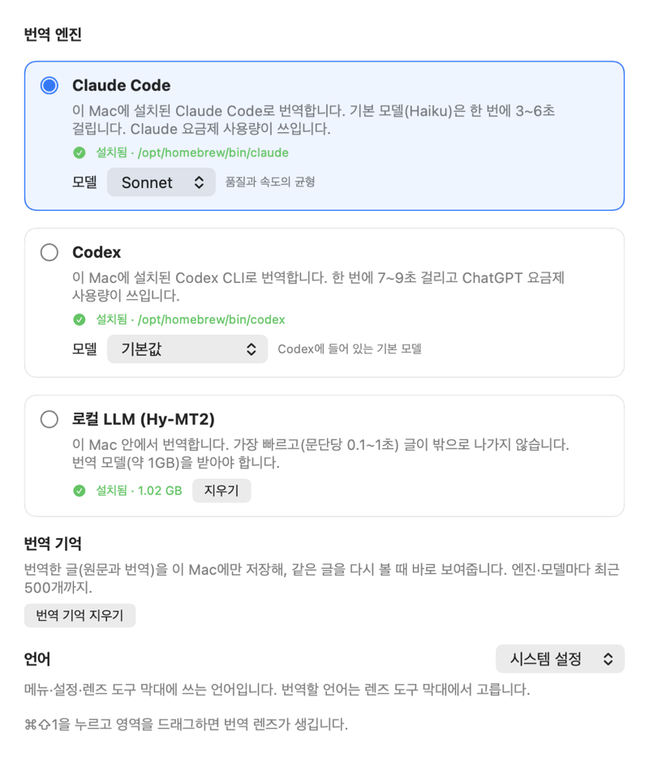

# AI Translate

**화면 어디서든, 원문 자리에 번역을**

**한국어** · [English](README.en.md)

<p align="center">
  
  <br><sub>왼쪽 원문, 오른쪽 렌즈. 이 README 의 그림은 모두 지어낸 예시 화면으로 만들었어요</sub>
</p>

맥 메뉴 막대에 사는 번역 앱이에요. `⌘⇧1` 을 누르고 화면에서 번역할 곳을 끌어 고르면 그 자리에 **번역 렌즈**가 떠요. 렌즈는 아래 글을 읽어서 **원문이 있던 자리에, 원문과 같은 색·크기로** 번역을 그려 주고, 스크롤하거나 영상이 흘러가면 알아서 다시 번역해요.

## 이 앱은 뭐예요?

외국어로 된 화면을 볼 때, 번역할 곳에 **돋보기 대신 번역 렌즈**를 올려 두는 거예요.

- 웹페이지, PDF, 앱 화면, 게임, **재생 중인 영상의 자막**까지 — 화면에 보이는 글이면 어디든 돼요.
- 렌즈를 올려 두면 계속 떠 있어요. 아래 페이지를 스크롤하거나 클릭해도 돼요(렌즈는 마우스를 통과시켜요).
- 번역은 원문 문단 자리에 원문의 바탕색·글자색으로 그리고, 나머지는 투명해서 페이지가 그대로 보여요.
- 이름·아이디·숫자·버튼·이모지처럼 번역할 필요가 없는 건 원래대로 둬요.

## 왜 만들었어요?

1. **브라우저 번역은 브라우저 안에서만 돼요** — 앱 화면, PDF 뷰어, 게임, 영상 위의 글은 못 해요.
2. **캡처해서 번역하는 도구는 한 번뿐이에요** — 스크롤할 때마다 다시 캡처하고, 결과는 다른 창에 따로 떠서 원문과 번갈아 봐야 해요.
3. **영상 자막은 흘러가요** — 자막이 바뀔 때마다 직접 옮길 수 없어요.

그래서 이 앱은 화면 일부를 계속 지켜보다가 바뀌면 다시 읽고, 새로 나온 글만 번역해서 원문 자리에 바로 덮어 보여 줘요.

## 설치하는 방법

> 지금은 내려받아 바로 여는 배포본(DMG)이 없어요. Apple 개발자 서명·공증을 받기 전이라 다른 맥에서 그대로 열리지 않아요. 아래처럼 코드로 직접 만들어 내 맥에 설치해요.

### 준비물

- 맥 컴퓨터 (macOS 15 이상). **로컬 번역 모델은 Apple 실리콘(M1~)에서만** 돼요. 인텔 맥에서는 아직 확인하지 않았어요
- [Xcode](https://apps.apple.com/app/xcode/id497799835) 26 과 Metal 툴체인 — 터미널에서 `xcodebuild -downloadComponent MetalToolchain` 한 번
- [XcodeGen](https://github.com/yonaskolb/XcodeGen) — `brew install xcodegen`
- 번역 엔진 중 하나 이상
  - **로컬 LLM** — 따로 준비할 것 없어요. 처음에 설정에서 번역 모델(약 1GB)을 받아요
  - [Claude Code](https://code.claude.com) (`claude`) — 설치하고 터미널에서 로그인해 둬요
  - [Codex CLI](https://github.com/openai/codex) (`codex`) — 설치하고 터미널에서 로그인해 둬요

### 따라 하기

1. **터미널을 열어요.** `⌘ + 스페이스` 를 누르고 "터미널"이라고 쓴 뒤 엔터를 쳐요.
2. **코드를 내려받아요.**
   ```bash
   git clone https://github.com/whalebanana86/ai-translate.git
   cd ai-translate
   ```
3. **이 맥 전용 서명 인증서를 만들어요** (처음 한 번만).
   ```bash
   ./scripts/setup-dev-signing.sh
   ```
   이 인증서로 서명해야 앱을 다시 만들어도 화면 기록 권한이 풀리지 않아요. Apple 계정은 필요 없고, 이 맥에서만 의미가 있어요.
4. **앱을 만들어 설치해요** (처음엔 4분쯤).
   ```bash
   ./scripts/install-release.sh
   ```
   응용 프로그램 폴더에 `AITranslate.app` 을 넣고 바로 열어요. 메뉴 막대에 말풍선 아이콘이 생겨요.
5. **번역 엔진을 골라요.** 처음 열면 시작 안내가 떠요. 로컬 LLM 을 고르면 **모델 받기**를 눌러요.
6. **화면 기록 권한을 허용해요.** 처음 렌즈를 만들 때 안내가 떠요. **시스템 설정 → 개인정보 보호 및 보안 → 화면 및 시스템 오디오 녹음**에서 AI Translate 를 켜요. 렌즈 영역을 읽으려면 이 권한이 꼭 필요해요.

### 새 버전으로 바꾸기 · 지우기

- 새 버전: `ai-translate` 폴더에서 `git pull && ./scripts/install-release.sh` 하면 새 앱으로 바꿔 넣어요(켜져 있던 앱은 끄고 다시 열어요). 설정과 받은 모델은 그대로예요.
- 지우기: `AITranslate.app` 을 휴지통에 넣어요. 받은 모델과 번역 기억까지 지우려면 `~/Library/Application Support/AITranslate` 폴더도 지우고, 설정은 `defaults delete com.example.AITranslate` 로 지워요. 서명 인증서는 `security delete-identity -c "AITranslate Local Development"`, 화면 기록 권한 기록은 `tccutil reset ScreenCapture com.example.AITranslate` 로 지워요.

## 쓰는 방법

### 렌즈 만들기

1. `⌘⇧1` 을 누르거나 메뉴 막대 아이콘에서 **번역 렌즈 만들기**를 눌러요.
2. 스크린샷 찍을 때처럼 번역할 곳을 끌어서 골라요. `esc` 로 그만둬요.
3. 렌즈가 떠서 바로 읽고 번역해요. 렌즈는 **만든 데스크톱(Space)에만** 있어요. 새 렌즈를 만들면 전 렌즈는 닫혀요.

### 렌즈 위 도구 막대

| 버튼 | 하는 일 |
|---|---|
| ≡ (끌기) | 렌즈 옮기기. 오른쪽 아래 손잡이로 크기를 바꿔요 |
| 언어 | 번역할 언어: 한국어, English, 日本語, 简体中文, 繁體中文, Español, Français, Deutsch |
| ⏸ 일시정지 | 읽기·번역을 멈추고 원문을 보여요. 다시 누르면 지금 화면부터 다시 읽어요 |
| 원문 함께 | 영상 자막을 원문 위에 번역과 함께 보여요(영상을 볼 때만 나와요) |
| 번역 기록 | 렌즈 옆에 지금까지 번역을 차례로 쌓아 보여요. 머리를 끌어 옮기고, 모서리를 끌어 크기를 바꿔요 |
| 원문 | 렌즈를 잠시 걷어 원문을 봐요 |
| 복사 · 닫기 | 번역 복사, 렌즈 닫기 |

버튼에 마우스를 올리면 하는 일이 툴팁으로 나와요.

### 렌즈가 알아서 하는 일

- **스크롤하면** 지난 번역을 바로 숨기고, 멈추면 새로 보이는 문단만 번역해요. 한 번 번역한 글은 기억해서 다시 올라가면 바로 보여요.
- **번역을 기다리는 문단**은 원문을 회색 막대로 가렸다가 번역이 나오면 그 자리에 그려요.
- **글자 크기와 굵기**는 화면에서 원문 글자를 재서 따라요. 굵은 제목은 굵게, 작은 회색 글은 작게 그려요. 같은 크기의 글은 같은 크기로 그려요. 글꼴 모양(명조 등)은 따라 하지 못해요.
- **이미 번역할 언어로 쓰인 줄**(한국어 화면의 "답글 4개" 등), **작성자 줄**("이름 @아이디 · 17분"), 숫자·버튼은 그대로 둬요.
- **이모지**는 번역하지 않고, 화면에 있던 그 이모지를 번역 문장 안 같은 자리에 다시 그려요.

### 영상 자막

<p align="center"></p>

- 영상이 재생 중이어도 번역해요. 유튜브 자막처럼 **글이 계속 바뀌는 곳**은 자막이 다 나온 뒤 번역하고, 자막마다 번역 위치가 흔들리지 않게 고정해요.
- 기본으로 **원문 자막 위에 번역을 함께** 보여 줘요(도구 막대 **원문 함께**로 끄면 번역이 원문을 가려요). 렌즈를 자막 줄에만 얇게 두르면 위아래에 자리가 없어서 원문을 가리는 방식으로 그려요.
- 원문이 두 줄이면 번역도 두 줄로 나눠요. 한국어로 번역할 때는 **합니다체**로 맞춰요.
- 자막 속도를 따라가는 건 **로컬 LLM** 뿐이에요(한 줄 약 0.35초). Claude Code·Codex 는 한 번에 몇 초씩 걸려요.

### 설정 (`⌘,`)

<p align="center"></p>

| 엔진 | 속도 | 글이 어디로 가요? |
|---|---|---|
| **Claude Code** | 기본 모델(Haiku)은 한 번에 3~6초. Sonnet·Opus·Fable 도 고를 수 있어요(더 정확하지만 느리고 사용량이 많아요) | 내가 로그인한 Claude Code 로 Anthropic 에. Claude 요금제 사용량이 쓰여요 |
| **Codex** | 한 번에 7~9초. Codex 가 받아 둔 모델 목록에서 고를 수 있어요 | 내가 로그인한 Codex 로 OpenAI 에. ChatGPT 요금제 사용량이 쓰여요 |
| **로컬 LLM** (Hy-MT2 1.8B) | 문단당 0.1~1초, 가장 빨라요 | 밖으로 나가지 않아요. Apple 실리콘 전용, 모델 약 1GB |

엔진이나 모델을 바꾸면 열린 렌즈가 바로 새 엔진으로 다시 번역해요. **번역 기억 지우기**로 저장해 둔 번역을 지워요.

**언어**에서 메뉴·설정·도구 막대에 쓰는 언어를 **시스템 설정**(기본)·**한국어**·**English** 중에서 골라요. 바꾸면 나오는 **다시 시작**을 눌러야 바뀌어요. 맥 언어가 한국어도 영어도 아니면 한국어로 나와요.

### 단축키

| 키 | 하는 일 |
|---|---|
| `⌘⇧1` | 번역 렌즈 만들기 |
| `esc` | 영역 고르기 그만두기 |
| `⌘,` | 설정 |
| `⌘Q` | 종료 (메뉴 막대 메뉴에서) |

## 내 화면은 안전해요?

- 이 앱에는 **가입도, 사용 통계 수집도 없어요.**
- 렌즈 영역만 캡처하고, 캡처한 그림은 **메모리에서만 쓰고 저장하지 않아요.** 글자 읽기(OCR)는 맥 안에서(Apple Vision) 해요.
- **로컬 LLM** 을 쓰면 글이 맥 밖으로 나가지 않아요. 모델은 처음 받을 때 한 번만 Hugging Face 에서 받고, 파일마다 해시를 확인해요.
- **Claude Code·Codex** 를 쓰면 렌즈에서 읽은 **글만** 내가 로그인한 CLI 를 거쳐 그 회사로 보내요(그림은 보내지 않아요). 엔진마다 처음 쓸 때 한 번 알려 줘요.
- CLI 는 도구를 모두 끄고(Claude Code) 또는 읽기 전용 샌드박스로(Codex), 빈 임시 폴더에서, 내 설정·훅을 읽지 않고 실행해요. 화면 글 안에 "이전 지시를 무시하라" 같은 문장이 있어도 지시가 아니라 번역할 글로만 다뤄요.
- 같은 글을 다시 번역하지 않도록 **번역 기억**(원문·번역)을 이 맥에만 저장해요(본인만 읽을 수 있게, 엔진·모델마다 최근 500개). 설정에서 지울 수 있어요. 번역 기록 패널의 기록은 메모리에만 있다가 렌즈를 닫으면 사라져요.
- 기록(log)에는 걸린 시간 같은 숫자만 남기고, 화면 글·번역은 남기지 않아요.

---

## 더 자세한 설명 (어른·개발자용)

### 구성

| | |
|---|---|
| 앱 | SwiftUI + AppKit 메뉴 막대 앱(Dock 아이콘 없음), Swift 6 엄격한 동시성. 렌즈는 포커스를 빼앗지 않는 패널 4개(본체·도구 막대·손잡이·번역 기록) |
| 화면 글 | 문자열 카탈로그 `Localizable.xcstrings`(앱·`TranslateCore`, 원문 한국어 + 영어). 언어 고르기는 macOS 앱별 언어(`AppleLanguages`)와 같은 값 |
| 캡처 | ScreenCaptureKit `SCScreenshotManager`. 이 앱의 창은 캡처에서 빼므로 렌즈가 덮어도 원문이 찍힌다 |
| OCR | Vision `RecognizeTextRequest`(언어 자동 감지 + 힌트 en·ko·ja·zh-Hans·zh-Hant). 줄을 문단으로 묶고, 단어 영역으로 이모지 자리를 찾는다 |
| 로직 | `Packages/TranslateCore`(Swift 패키지): 좌표 변환, 변화 감지, 문단 묶기, 자막 자리, 이모지, 언어 판별(NaturalLanguage), 글자 크기·굵기 재기, 번역 기억, 엔진. `swift test` 로 검증 |
| 엔진 | Claude Code CLI, Codex CLI, 로컬 [mlx-swift-lm](https://github.com/ml-explore/mlx-swift-lm) + `mlx-community/Hy-MT2-1.8B-4bit`(리비전·해시 고정) |
| 프로젝트 | XcodeGen(`project.yml`). `.xcodeproj` 는 생성물 |

처리 흐름: 캡처(평소 0.5초, 화면이 바뀌는 중 0.15초마다) → 지문으로 변화 감지 → 바뀐 뒤 멈추면(영상은 바뀌는 중에도 0.25초마다) OCR → 이모지·글자 크기와 굵기·문단·색 → 번역 기억에 없는 문단만 엔진에 (요청은 동시에 하나) → 원문 자리에 그리기.

### 앱이 실행하는 명령

| 엔진 | 명령 |
|---|---|
| Claude Code | `claude -p --model <haiku·sonnet·opus·fable> --tools "" --strict-mcp-config --setting-sources project --no-session-persistence --system-prompt <번역 전용> --json-schema <스키마> --output-format json` (표준 입력으로 JSON 세그먼트) |
| Codex | `codex exec --skip-git-repo-check --ephemeral --ignore-user-config --sandbox read-only --cd <빈 폴더> --config model_reasoning_effort="low" [--model <모델>] --output-schema <스키마> --output-last-message <파일> -` |
| 로컬 | 앱 안에서 MLX 로 생성. 모델 카드 번역 프롬프트, 문단 하나씩, 생성되는 대로 보여 준다 |

화면 글은 `{"target": "Korean", "segments": [...]}` JSON 으로만 넘기고 출력은 스키마로 강제한 뒤 세그먼트 개수를 확인한다. 모든 호출에 시간 제한이 있고, 새 요청이 오면 이전 프로세스를 끝낸다. GUI 앱은 셸 PATH 를 물려받지 않으므로 CLI 는 로그인 셸(`zsh -lc 'command -v claude'`)과 알려진 설치 경로로 찾는다.

### 측정

| | |
|---|---|
| 로컬 모델 (M5) | 불러오기 1.25초, 초당 101~112토큰. 짧은 문구 0.14초, 한 줄 0.35초, 긴 문단 1.2초 |
| 유튜브 자막 | 자막이 나온 뒤 번역이 보일 때까지 약 1.1초(다 나온 뒤 번역하는 대기 포함) |
| 병렬 번역 | 하지 않는다: 댓글 8개를 하나씩 2.6~2.8초, 2개 동시 2.4~2.5초, 4·8개 동시 약 2.5초(GPU 하나를 나눠 씀) |
| 대상 언어 건너뛰기 | 한국어 유튜브 댓글 한 화면: 번역할 수 있던 문단 12개 → 엔진에 보낸 문단 5개 |
| 자막 합니다체 | 로컬 모델, 평서문 50개: 문체 지시 전 25개 → 시스템 메시지로 지시한 뒤 50개 |
| 이모지 찾기 | 3200×1520 화면에서 약 5ms |
| 글자 크기 재기 | 같은 글꼴 안 흔들림(90%) Chrome 2배 화면 ±2.2%·1배 ±4.3% (예전 줄 상자 식 ±36~40%). 화면 한 장 약 11ms |
| 굵기 재기 | 26px 이상에서 보통 ↔ 굵게를 바꿔 본 줄 없음 (그린 글 1663줄) |

결정과 근거, 측정 기록은 [AGENTS.md](AGENTS.md)와 `.agent/archive/TASK-*.md` 에 있다.

### 개발

```bash
xcodebuild -downloadComponent MetalToolchain       # Xcode 26: MLX 빌드에 필요 (한 번)
xcodegen generate                                  # AITranslate.xcodeproj 생성 (project.yml 을 바꾼 뒤 항상)
./scripts/setup-dev-signing.sh                     # 개발 서명 인증서 (한 번)
./scripts/run-app.sh                               # 개발 빌드 → 서명 → 실행 (실행 중이면 다시 시작)
./scripts/install-release.sh                       # 이 맥용 Release 빌드를 /Applications 에 설치·실행
./scripts/sync-strings.sh                          # 빌드 뒤 새 화면 글을 문자열 카탈로그에 더하기 (영어 번역은 직접 채움)
swift test --package-path Packages/TranslateCore   # 로직 테스트
AITRANSLATE_LIVE_TESTS=1 swift test --package-path Packages/TranslateCore --filter LiveTests   # 실제 엔진 호출 (수동)
./scripts/auto-fix-loop.sh                         # 타입 검사·Lint·빌드·테스트 (작업을 끝내기 전에 꼭)
```

작업 규칙(에이전트 포함)은 [AGENTS.md](AGENTS.md)에 있다. 요청마다 `.agent/tasks/TASK-ID.md` 에 요구사항과 완료 조건을 적고, `auto-fix-loop.sh` 검증을 통과해야 완료로 본다. 테스트할 수 있는 로직은 `TranslateCore` 에 두고 앱 타깃은 얇게 둔다.

### 아직 안 되는 것

- Developer ID 서명·공증, DMG 배포, 자동 업데이트(Sparkle) — 그래서 내려받기가 없다
- API 키로 쓰는 엔진 — Anthropic 은 다른 회사 앱에서 claude.ai 로그인·요금제 한도를 쓰는 것을 허용하지 않으므로, 정식 배포 전에 필요하다
- 인텔 맥 확인, 로그인할 때 자동 실행
- 글꼴 모양(세리프 등)은 옮기지 않는다. 2배 화면 13pt(26px)보다 작은 글자는 굵기를 재지 않고 보통으로 그린다(1배 화면의 본문 대부분), 1.1배보다 작은 글자 크기 차이는 구분하지 않는다
- 회색 한 가지 색 이모지(💀 등)는 못 찾을 수 있다. 키보드 스크롤은 화면 변화로만 알아챈다(최대 약 0.5초)
- 자막 합니다체: 질문·권유는 해요체("~나요?", "~보세요")로 남는 경우가 많다
- Windows·Android·iPhone — 조사만 했다

## 라이선스

아직 정하지 않았어요.
