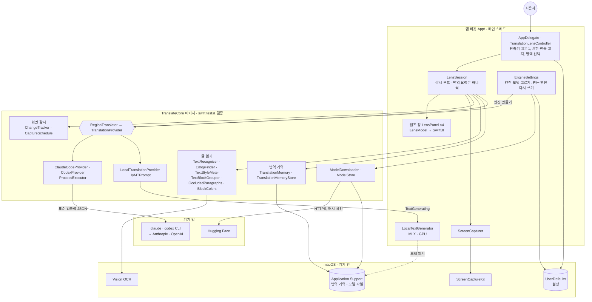
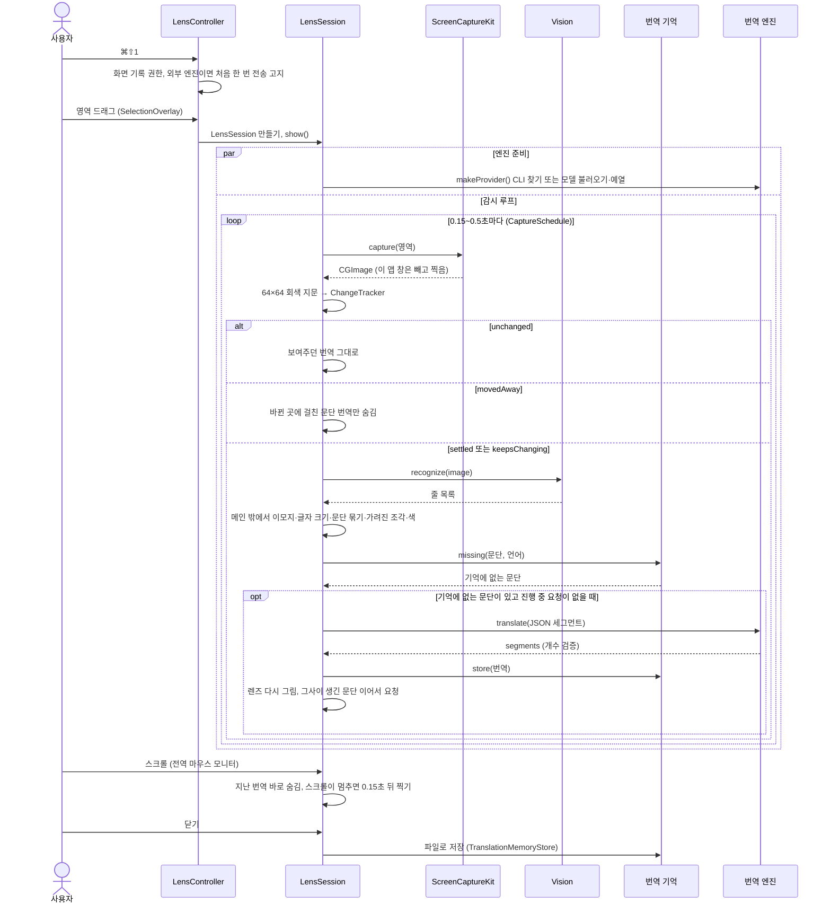

# 전체 구조·저장 형식·통신 형식

다루는 범위: 앱 전체를 박스와 선으로 본 구조, 렌즈 한 번의 처리 순서(시퀀스), 저장하는 데이터 형식, 바깥과 주고받는 형식(엔진 CLI·
로컬 모델·모델 받기), 모듈 경계(공개 인터페이스), 느려질 때 짐작할 곳, 사람이 꼭 리뷰할 변경.

저장 형식·통신 형식·공개 인터페이스를 바꾸기 전에 읽고, 바꾼 뒤 여기를 갱신한다. 기능별 동작과 경위는 영역 문서(AGENTS.md 3장 표)에,
보안·개인정보 규칙은 [AGENTS.md](../../AGENTS.md) 4장에 있다 (이 문서보다 우선한다).

## 1. 박스와 선

서버와 DB가 없다. 앱 하나가 화면을 찍고(ScreenCaptureKit), 기기 안에서 글을 읽고(Vision), 번역 엔진 하나에 글만 보낸다.
기기 밖으로 나가는 길은 CLI 엔진 두 개(사용자가 설치·로그인한 `claude`·`codex`)와 로컬 모델 받기(Hugging Face)뿐이다.

- 앱 타깃은 얇게 두고 로직은 TranslateCore에 둔다. 앱 타깃에는 테스트가 없다(규칙 검사만 `ProjectRulesTests`가 소스로 본다)
- 화살표가 TranslateCore → App으로 가는 곳은 프로토콜 하나다: `LocalTranslationProvider`는 `TextGenerating`만 알고, MLX를
  쓰는 구현(`LocalTextGenerator`)은 앱 타깃에 있다
- 렌즈는 한 번에 하나(`TranslationLensController.lens`). 새로 만들면 이전 렌즈를 닫는다

## 2. 렌즈 한 번의 처리 순서

- 엔진 준비와 첫 인식은 함께 진행한다. 엔진이 늦게 준비되면 준비된 뒤 기다리던 문단을 보낸다(`prepareTranslator`)
- 같은 화면이면 OCR하지 않는다. 바뀐 뒤 한 번 더 같게 찍혀야(멈춤) 인식한다. 영상처럼 0.6초 넘게 계속 바뀌면 바뀌는 중에도
  0.25초마다 인식한다 (`docs/design/capture.md`, `docs/design/video.md`)
- 번역 기억 키는 OCR 글 그대로 + 대상 언어다. OCR이 한 글자만 다르게 읽어도 새 문단으로 보고 다시 번역한다

## 3. 저장하는 데이터 (DB 대신)

DB가 없다. 저장하는 것은 세 가지이고, 모두 이 맥 안에 있다. 이 형식들이 이 앱의 "스키마"다.

| 무엇 | 어디 | 형식 | 코드 |
|---|---|---|---|
| 번역 기억 | `~/Library/Application Support/AITranslate/TranslationMemory/<엔진>.json`, 기본 모델이 아니면 `<엔진>-<모델>.json` | JSON 배열 `[{"text": 원문, "language": "ko", "translation": 번역}]`, 오래된 것부터, 파일마다 최근 500개, 권한 0600, 통째로 덮어씀(atomic) | `TranslationMemory.Entry`, `TranslationMemoryStore` |
| 로컬 모델 | `~/Library/Application Support/AITranslate/Models/hy-mt2-1.8b-4bit/` (받는 중 `….partial`) | Hugging Face 파일 8개(약 1GB). 리비전·크기·해시 고정 | `LocalModel.hyMT2`, `ModelStore` |
| 설정 | UserDefaults (번들 ID 도메인) | 아래 키 | `EngineSettings`, `TranslationLensController` 등 |

UserDefaults 키:

| 키 | 값 |
|---|---|
| `TranslationEngine` | `claude-code` · `codex` · `local` (`TranslationEngine` 원시값) |
| `ClaudeModel`, `CodexModel` | 모델 이름 (없으면 기본값: Claude `haiku`, Codex는 Codex 기본) |
| `TargetLanguage` | `ko` · `en` · `ja` · `zh-Hans` · `zh-Hant` · `es` · `fr` · `de` (`TargetLanguage` 원시값) |
| `TranscriptVisible`, `BilingualCaptions`, `TranscriptSize` | 번역 기록 패널 보임, 이중 자막(없으면 켬), 패널 크기 `[너비, 높이]` |
| `DataTransmissionNoticeAccepted`, `DataTransmissionNoticeAccepted.codex` | 전송 고지 동의 (Claude는 엔진 선택이 생기기 전 키를 그대로 쓴다) |
| `ScreenRecordingPermissionRequested` | 화면 기록 권한을 한 번 요청했는지 |
| `AppleLanguages` (앱 도메인) | 앱 화면 언어 (`AppLanguage`) |
| `KeyboardShortcuts_translateRegion` | 사용자가 바꾼 단축키 (KeyboardShortcuts 패키지가 저장) |

바꾸면 깨지는 것:

- 번역 기억은 읽지 못하면 오류 없이 빈 기억이 된다(`load`가 실패를 삼킨다). `Entry` 필드 이름, `TargetLanguage`·
  `TranslationEngine` 원시값, 파일 이름 규칙을 바꾸면 이전 파일이 조용히 버려지고, 같은 페이지를 다시 번역하느라 요금제 사용량이 다시 든다.
  파일에 형식 버전이 없다
- 테스트는 요청 JSON을 바이트 그대로 고정하지만(`TranslationPayloadTests`), 번역 기억 파일은 저장→읽기 왕복과 파일 이름만 본다
  (`TranslationMemoryStoreTests`). 필드 이름을 바꿔도 테스트는 통과한다
- UserDefaults 키 이름을 바꾸면 그 설정이 처음 상태가 되고, 동의 키를 바꾸면 전송 고지가 다시 뜬다. 앞선 예: 모델 고르기를
  더할 때 기본 모델은 옛 파일 이름(`<엔진>.json`)을, 엔진 고르기를 더할 때 Claude는 옛 동의 키를 그대로 썼다(TASK-053 등)
- 번들 ID(`com.example.AITranslate`, 임시값)를 배포 전에 바꾸면 UserDefaults 도메인과 화면 기록 권한(TCC)이 새 앱 기준이 된다:
  설정·동의·권한이 모두 처음 상태가 된다. 번역 기억·모델은 폴더 이름(`AITranslate`)이라 그대로 남는다
- `LocalModel.id`를 바꾸면 설치 안 된 것으로 보고 1GB를 다시 받는다

## 4. 바깥과 주고받는 형식 (통신 프로토콜)

네트워크 서버를 직접 부르지 않는다. 바깥과의 약속은 CLI 프로세스의 표준 입출력, 로컬 모델 프롬프트, 파일 받기다.
앱이 정하는 쪽(바꾸면 사람이 리뷰)과 바깥 프로그램이 정하는 쪽(업데이트되면 깨질 수 있어 Live 테스트로 확인)이 섞여 있다.

| 상대 | 보내는 것 | 받는 것 | 형식을 정하는 쪽 |
|---|---|---|---|
| `claude -p` | 표준 입력 `{"segments":[…],"style":…,"target":"Korean"}` (키 정렬, `style`은 있을 때만), 인자로 시스템 프롬프트·출력 스키마 | 표준 출력 JSON의 `structured_output`(`{"segments":[…]}`), 실패는 `is_error`·`result`·`subtype` | 요청·스키마·프롬프트는 앱, 응답 껍데기는 Claude Code |
| `codex exec` | 표준 입력 = 시스템 프롬프트 + 빈 줄 + 같은 JSON, 스키마 파일(`--output-schema`) | 출력 파일(`--output-last-message`)의 `{"segments":[…]}`, 실패는 표준 오류 끝 600자 | 요청·스키마는 앱, 인자·파일 동작은 Codex |
| Hy-MT2 (MLX) | 문단 하나씩 모델 카드 프롬프트(특수 토큰 포함 문자열), 문체는 시스템 메시지 | 생성 글 (중간 글을 계속 받음) | 모델 카드 |
| Hugging Face | `GET https://huggingface.co/<저장소>/resolve/<리비전>/<파일>` | 파일. 크기와 SHA-256(LFS)·git 블롭 SHA-1을 확인 | Hugging Face, 해시는 앱에 고정 |
| Codex 모델 목록 | (읽기만) `~/.codex/models_cache.json` | `models[].slug`·`display_name`·`visibility`·`priority` | Codex. 못 읽으면 빈 목록 |

- 공통 출력 스키마: `{"type":"object","properties":{"segments":{"type":"array","items":{"type":"string"}}},"required":["segments"],"additionalProperties":false}`.
  받은 세그먼트 개수가 요청과 다르면 버린다(`TranslationPayload.validate`)
- 시간 제한: Claude Haiku 60초·그 밖 모델 180초, Codex 90초, 로컬 문단마다 10초 + 토큰 상한(글자 수 × 3, 64~2048) × 0.1초
- 실행: `ProcessExecutor`만 쓴다. 시간 제한을 넘기거나 Task가 취소되면 SIGTERM, 2초 뒤에도 살아 있으면 SIGKILL. 요청마다 빈 임시 폴더
- 검증한 CLI 버전은 AGENTS.md 4장(claude 2.1.314, codex-cli 0.155.0). CLI가 업데이트되면
  `AITRANSLATE_LIVE_TESTS=1 swift test --package-path Packages/TranslateCore --filter LiveTests`로 다시 확인한다

## 5. 공개 인터페이스

바깥에 여는 API가 없다(서버, URL 스킴, 플러그인 없음). 공개 인터페이스에 해당하는 것은 모듈 경계와 사용자에게 보이는 약속이다.

- `TranslationProvider` (번역 엔진 공통 인터페이스): `translate(_:)`, `translate(_:onPartial:)`, `preferredBatchSize`,
  `firstBatchSize`. UI와 다른 로직은 이 프로토콜에만 기댄다. 출시 전 API 키 엔진(BYOK)도 이 뒤에 붙인다(AGENTS.md 2장 출시 조건)
- `TextGenerating`: 로컬 모델 생성기. TranslateCore가 정하고 앱 타깃(MLX)이 구현한다
- `TranslationRequest`·`TranslationResult`: 모듈 경계이자 CLI로 나가는 JSON 형식이다(4장). 필드를 바꾸면 통신 형식이 바뀐다
- `TranslationEngine`·`TargetLanguage`: 원시값이 저장 형식(3장)이기도 하다
- 사용자에게 보이는 약속: 기본 단축키 ⌘⇧1, 설정 화면의 엔진·모델 선택, "번역 기억 지우기"

## 6. 느려질 때 짐작할 곳

동시성:

- 앱 타깃의 컨트롤러·렌즈·캡처·설정(`TranslationLensController`, `LensSession`, `LensModel`, `ScreenCapturer`, `EngineSettings`)은
  메인 스레드(`@MainActor`)다. 여기서 무거운 일을 하면 렌즈 이동·메뉴가 멈춘다. 그래서 화면 픽셀을 다시 읽는 일(이모지·글자 크기·
  문단 묶기·가려진 조각·색)은 `Task.detached`로 메인 밖에서 한다
- 캡처·OCR·엔진 호출은 `await`로 기다린다. 엔진은 별도 프로세스(CLI)나 GPU(MLX)에서 돈다
- 번역 요청은 동시에 하나(`translateTask`). 병렬로 보내도 빨라지지 않았다(로컬 모델 8개 동시 ≈ 하나씩, GPU 하나를 나눠 씀, TASK-045)
- 늦게 끝난 결과가 새 상태를 덮지 않게 요청 번호(`translateGeneration`)·엔진 번호(`engineGeneration`)로 버린다. 화면에서 대부분
  지나간 요청은 취소하고 지금 화면부터 번역한다(`TranslationScheduling.shouldAbandon`). 버린 요청의 번역도 기억에는 넣는다

비용(알고리즘):

- 화면 비교는 64×64 회색 지문의 평균 밝기 차이라 싸고, OCR은 비싸다. 그래서 멈췄을 때만 OCR한다. 기준값: 같은 화면 0.0005 미만,
  번역 숨김 0.005 초과 (4px 스크롤 0.018, 단어 하나 0.0010)
- 문단 묶기는 줄마다 모든 문단과 비교한다. 비교 안에서 정규식을 매번 만들어 27줄 화면에서 220ms가 걸린 적이 있다 → 12ms (TASK-061)
- 픽셀 작업은 Release 빌드 화면 한 장 약 11ms, Debug 빌드는 수백 ms다. 느리면 먼저 Debug 빌드인지 본다

엔진(네트워크에 해당):

- Claude는 요청마다 약 3초 고정 비용이 있어 묶어 보내되, 새 화면 첫 요청은 위 3문단만 보낸다(`firstBatchSize`). Haiku 한 번 3~6초
- Codex는 한 번 7~9초, 약 1만 4천 토큰(자체 지시문 포함)
- 로컬은 문단 하나씩 보내 생성되는 대로 그린다(0.05초 간격). M5 측정: 불러오기 1.25초, 초당 101~112토큰, 첫 생성은 GPU 준비로
  4.3초라 불러올 때 예열한다. 엔진은 `EngineSettings`가 만들어 두고 새 렌즈에서도 다시 쓴다

재는 법: `/usr/bin/log stream --level info --predicate 'subsystem == "com.example.AITranslate"'`. 숫자만 남긴다(글 내용 없음).

| 로그 | 뜻 |
|---|---|
| `인식(멈춤 / 계속 바뀜): 캡처 · OCR · 문단·이모지·색·글자 · 배치 …ms` | 화면 한 번 처리의 단계별 시간, 문단 수(번역 필요·가려짐) |
| `엔진 준비: <엔진> …ms` | CLI 찾기·모델 불러오기 |
| `번역: <엔진> 문단 N개 …ms` | 요청 하나 |
| `모두 표시: 변화 후 …ms` | 화면이 바뀐 뒤 번역이 다 보일 때까지 (사용자가 느끼는 시간) |
| `지나간 화면 번역 취소` | 스크롤이 번역보다 빨라 요청을 버림 |

증상별로 먼저 볼 곳:

| 증상 | 먼저 볼 곳 |
|---|---|
| 스크롤을 멈춘 뒤 번역이 늦게 뜬다 | 로그 `모두 표시`·`인식`의 단계별 시간, `CaptureSchedule`, `ChangeTracker` 기준값 |
| 렌즈·메뉴가 버벅인다 | 메인 스레드에서 도는 `LensSession.tick`·`refreshParagraphs`, Debug 빌드인지 |
| 번역 대기만 계속된다 | 엔진 시간 제한·`ProcessExecutor`, 렌즈의 주황색 오류 띠·도구 막대 경고 아이콘의 메시지(로그인 만료·사용량 한도 등) |
| 같은 페이지인데 또 번역한다 | 번역 기억 키(OCR 글 그대로), 파일마다 500개 한도, 엔진·모델별 파일 |
| 번역이 엉뚱한 자리에 그려진다 | `ScreenGeometry`(좌표 변환), `LensGeometry` |
| 글자 크기·색이 들쭉날쭉하다 | `TextStyleMeter`, `FontSizer`, `BlockColors` (`docs/design/lens.md`) |

모르는 영역을 깊게 팔 때는 AGENTS.md 3장 표에서 영역 문서를 찾아 측정값과 "실패한 방법"부터 읽는다. 같은 실패를 되풀이하지 않기 위해서다.

## 7. 사람이 꼭 리뷰할 변경

에이전트가 고쳐도 아래에 닿는 변경은 사람이 diff를 본다. 앞 세 묶음은 사용자 기기에 남은 데이터·바깥 프로그램과의 약속이라
테스트가 통과해도 깨질 수 있다.

- 저장 형식(3장): `TranslationMemory.Entry` 필드, `TranslationMemoryStore.file(for:model:)` 파일 이름, `TargetLanguage`·
  `TranslationEngine` 원시값, UserDefaults 키, `LocalModel`의 id·리비전·해시, 번들 ID
- 통신 형식(4장): `TranslationPayload`(요청 JSON·출력 스키마), `TranslationPrompt.system`, CLI 인자
  (`ClaudeCodeProvider.arguments`, `CodexProvider.arguments(…)`), `HyMTPrompt`, 시간 제한 값
- 공개 인터페이스(5장): `TranslationProvider`, `TextGenerating`, 기본 단축키
- 보안·개인정보 경계(AGENTS.md 4장): 파일을 쓰는 곳, 외부 프로세스 실행, 로그에 남기는 값, CLI 도구·샌드박스 옵션.
  일부는 `ProjectRulesTests`가 소스에서 검사한다(시스템 프롬프트 문구, 파일 쓰기·프로세스 실행 허용 목록, Live 테스트 조건)
